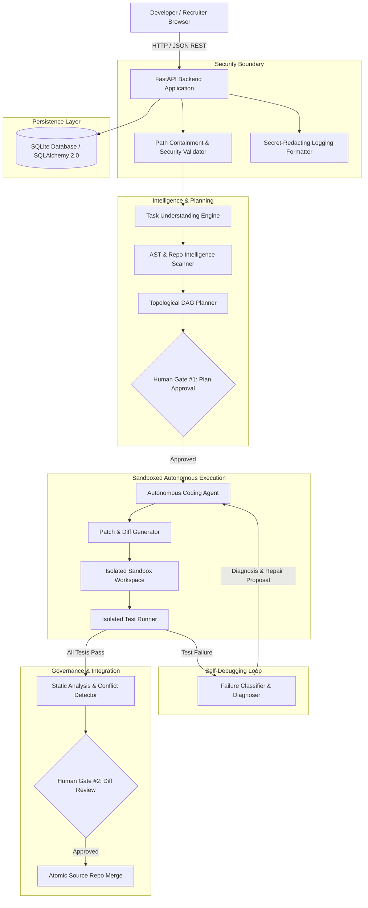
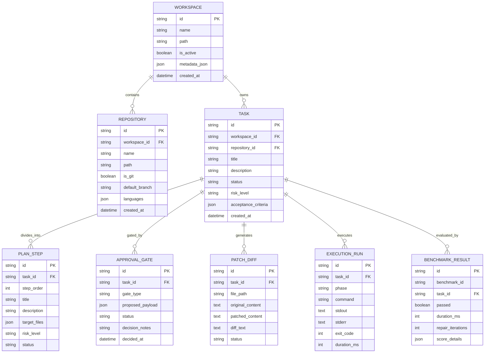
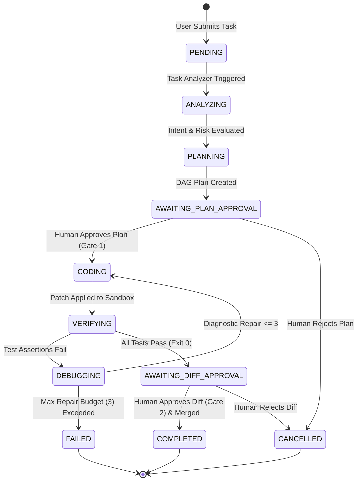

# AETHER ENGINEER — System Architecture & Design Specification
### *From Requirement to Verified Code*

This document provides the formal system design specification, component architecture, database entity relationships, state machines, and Architecture Decision Records (ADRs) for the **AETHER ENGINEER** platform.

---

## 1. Executive Architecture Summary

AETHER ENGINEER is an autonomous software engineering system designed to bridge the gap between generative AI probabilistic code completions and deterministic engineering verification. The platform enforces four architectural tenets:
1. **Zero Untrusted Host Modification:** All generation and testing takes place inside isolated disposable workspaces; original source repositories are never touched during agent reasoning.
2. **Dual Human-in-the-Loop Governance:** Autonomous execution is bounded by two explicit human approval gates (Plan Approval and Diff Approval).
3. **Deterministic Test-Driven Verification:** No code is deemed resolved without passing objective, cross-language test suites (`pytest`, `vitest`, `node`).
4. **Hardware & Resource Efficiency:** Engineered specifically for local developer machines (Apple Silicon Mac M1 with 8 GB RAM), maintaining a sub-100 MB resident memory footprint.

---

## 2. High-Level System Topology

---

## 3. Component Deep Dive

### 3.1 Task Understanding Engine (`services/task_understanding/task_analyzer.py`)
- **Intent Classification:** Classifies user prompts into one of five intents: `INFORMATION_REQUEST`, `READONLY_ANALYSIS`, `CODE_MODIFICATION`, `TEST_EXECUTION`, or `HIGH_RISK_OPERATION`.
- **Category Taxonomy:** Categorizes tasks into `BUG_FIX`, `FEATURE_IMPLEMENTATION`, `REFACTORING`, `TEST_GENERATION`, `DEPENDENCY_UPDATE`, or `SECURITY_HARDENING`.
- **Ambiguity Detection:** Computes an ambiguity score ($0.0 \le \text{score} \le 1.0$) based on missing technical details, target filenames, and expected behavior, generating targeted clarification questions when ambiguous.
- **Automated Acceptance Criteria:** Synthesizes structured, testable acceptance criteria ($AC_1, AC_2, \dots$) required for verification.
- **Risk Assessment:** Evaluates destructive commands, security keywords, and directory scope to categorize risk (`LOW`, `MEDIUM`, `HIGH`, `CRITICAL`), mandating human approval gates.

### 3.2 Topological DAG Planner (`services/orchestrator/dynamic_planner.py`)
- **Dependency Ordering:** Converts multi-file implementation requirements into a Directed Acyclic Graph (DAG) of steps. Steps with prerequisites are scheduled topographically using Kahn's algorithm.
- **Deadlock & Cycle Detection:** Detects circular step dependencies and raises structured validation errors before execution starts.
- **Scope Creep Evaluation:** Evaluates proposed step modifications against the initial task objective to flag unauthorized scope expansion.

### 3.3 Isolated Sandbox & Coding Engine (`services/coding_engine/`)
- **Sandbox Creation:** Copies target repository contents into an isolated directory (`workspaces/isolated/{task_id}`).
- **Patch Engine (`patch_engine.py`):**
  - Enforces path containment checks verifying that candidate files do not escape the sandbox root via `../` or symlinks.
  - Generates unified git diffs with exact line offsets.
  - Rejects sensitive file edits (`.env`, `.pem`, `.key`, `id_rsa`).

### 3.4 Verification & Self-Debugging Engine (`services/verification/`, `services/debugging/`)
- **Subprocess Isolation:** Executes test runners (`pytest`, `vitest`, `node`) in sanitized child processes.
- **Environment Sanitization:** Strips all API keys, database credentials, and host environmental variables before spawning test commands.
- **Timeout Enforcement:** Kills stuck or runaway processes after 60 seconds (`SIGTERM` followed by `SIGKILL`).
- **Failure Classification:** Categorizes failure outputs using regex and AST into `ASSERTION_ERROR`, `SYNTAX_ERROR`, `IMPORT_ERROR`, `TYPE_ERROR`, or `TIMEOUT_ERROR`.
- **Bounded Repair Loop:** Limits repair cycles to `MAX_REPAIR_ATTEMPTS = 3`, halting with complete diagnostic logs if the budget is exhausted.

### 3.5 Review & Safe Application Engine (`services/review/`)
- **External Modification Check:** Reads the original source file hashes prior to merge. If an external edit occurred while the agent was running, the merge is blocked with HTTP 409 Conflict.
- **Static Analysis Gate:** Scans candidate patches for dangerous primitives (`eval`, `exec`, `os.system`, shell piping) before presenting to the developer.

---

## 4. Database Schema & Entity Relationships

---

## 5. Agent State Machine & Governance Lifecycle

---

## 6. Architecture Decision Records (ADRs)

### ADR-001: Isolated Sandbox Workspaces vs In-Place Code Editing
- **Status:** Accepted
- **Context:** Agentic coding platforms often edit working trees directly, risking corrupted codebases or accidental file deletions if the agent hallucinates.
- **Decision:** All autonomous edits, builds, and test executions must occur in an isolated clone (`workspaces/isolated/{task_id}`).
- **Consequences:** Eliminates host corruption. Requires cloning step (~50ms for typical repos) and sandbox garbage collection.

### ADR-002: Dual Human-in-the-Loop Governance Gates (Plan & Diff)
- **Status:** Accepted
- **Context:** Fully autonomous coding without oversight can introduce breaking architectural decisions or subtle logic flaws.
- **Decision:** Enforce two explicit human approval checkpoints: Gate #1 (approving proposed plan steps) and Gate #2 (approving verified unified diffs).
- **Consequences:** Retains developer control. Prevents unauthorized code changes while automating the tedious authoring and debugging cycles.

### ADR-003: Provider-Agnostic LLM Gateway with Strict Pydantic Output
- **Status:** Accepted
- **Context:** Tying the architecture to a single proprietary LLM API limits deployment options and increases vendor lock-in.
- **Decision:** Implement a clean `BaseLLMAdapter` interface supporting Gemini, Anthropic, OpenAI, local Ollama, and deterministic mock adapters. All model outputs are strictly validated into Pydantic models. Unconfigured models fail immediately without faking responses.
- **Consequences:** Seamless provider switching, zero mock hallucinations, robust schema validation.

### ADR-004: AST-Based Symbol Extraction vs Heavy Language Server Daemons
- **Status:** Accepted
- **Context:** The development target is Apple Silicon Mac M1 with 8 GB RAM. Running full language servers (Pyright, rust-analyzer, tsserver) continuously consumes 2–4 GB RAM.
- **Decision:** Use Python's built-in `ast` module and lightweight regex tokenizers for repository intelligence and symbol extraction.
- **Consequences:** Memory footprint drops below 20 MB for AST parsing; achieves < 100ms repository indexing for 1,000+ files.

### ADR-005: Process-Level Test Isolation & Strict Command Allowlisting
- **Status:** Accepted
- **Context:** Running untrusted generated code can lead to command injection or system command execution.
- **Decision:** Subprocesses execute via `subprocess.Popen` without shell invocation (`shell=False`). Only commands matching the strict executable allowlist (`pytest`, `vitest`, `npm`, `python`, `node`, `tsc`) are allowed.
- **Consequences:** Completely prevents command chaining (`&&`, `|`, `;`), curl piping, or unauthorized binary execution.

### ADR-006: Bounded Self-Debugging Loop (Max 3 Iterations)
- **Status:** Accepted
- **Context:** Agents attempting to self-debug can enter infinite cyclic loops, draining tokens and freezing developer systems.
- **Decision:** Hardcode `MAX_REPAIR_ATTEMPTS = 3`. Each iteration records error classification, root-cause hypothesis, and patch attempts.
- **Consequences:** Guaranteed termination. If 3 attempts fail, system halts safely with structured diagnostics for developer review.

### ADR-007: Secret Redaction & Canonical Path Validation Firewall
- **Status:** Accepted
- **Context:** Repositories frequently contain `.env` files, API keys, or private keys that must never be uploaded to LLM providers or logged to disk.
- **Decision:** Implement a centralized security firewall that resolves canonical symlinks and verifies containment within `ALLOWED_REPO_ROOTS`. Scrub all known secret formats (`sk-`, `ghp_`, `AIzaSy`, `Bearer`) across logs and LLM payloads.
- **Consequences:** Zero credential leakage in logs or context windows. Rejects directory traversal attacks at the API entrypoint.

### ADR-008: SQLite + SQLAlchemy 2.0 with Alembic for Zero-Daemon Persistence
- **Status:** Accepted
- **Context:** Running a full PostgreSQL container on 8 GB RAM consumes 400–800 MB idle memory and complicates local setup.
- **Decision:** Use SQLite with WAL (Write-Ahead Logging) mode and SQLAlchemy 2.0 with async-capable ORM mappings and Alembic migrations.
- **Consequences:** Zero background daemon footprint, instantaneous zero-configuration startup, portable single-file database.

### ADR-009: React 18 + TanStack Query + Tailwind CSS for Unified 4-Panel IDE
- **Status:** Accepted
- **Context:** Developers need visibility into file trees, code, plans, and test outputs without switching browser tabs.
- **Decision:** Build a single-page 4-panel IDE layout (Left File Tree, Center Code Editor, Right AI Assistant, Bottom Test Drawer) powered by React 18, TanStack Query for polling state, and Tailwind CSS dark technical palette.
- **Consequences:** High-productivity UX comparable to desktop IDEs, sub-second hot reload, responsive desktop performance.

### ADR-010: Independent Benchmark Evaluation Engine with Hidden Test Separation
- **Status:** Accepted
- **Context:** Benchmarks where agents can read the evaluation assertions suffer from test data contamination and overfitting.
- **Decision:** The benchmark harness separates repository files from acceptance test files. Acceptance tests are stored outside the agent's context and executed independently by the `IndependentEvaluationEngine`.
- **Consequences:** Scientifically valid evaluation, zero test leakage, verifiable ground-truth metrics.

---

## 7. Security Architecture & Threat Model

| Threat Vector | Mitigation Strategy | Architectural Enforcement |
|---|---|---|
| **Directory Traversal** | Reject paths escaping workspace root | `validate_safe_path()` checks `resolved_path.parents` against allowlist |
| **Symlink Escapes** | Forbid resolving outside roots | `target_path.resolve()` resolves realpath and checks containment |
| **Command Injection** | Prevent arbitrary shell commands | `sanitize_command()` parses args as vector; `shell=False` always enforced |
| **Secret Exfiltration** | Strip sensitive tokens | `SecretRedactor` regex scrubs API keys from stdout, logs, and prompt contexts |
| **Prompt Injection** | Detect override keywords | `HIGH_RISK_KEYWORDS` scanner flags prompt overrides and escalates to `CRITICAL` risk |
| **Host Overwrite** | Prevent unapproved merges | Dual approval gates; file hashes verified prior to final merge |
| **Resource Exhaustion** | Prevent runaway execution | 60s test timeouts; max 3 repair attempts; sub-100 MB memory profiling |
